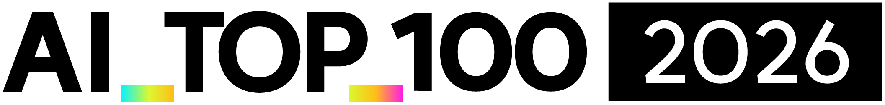
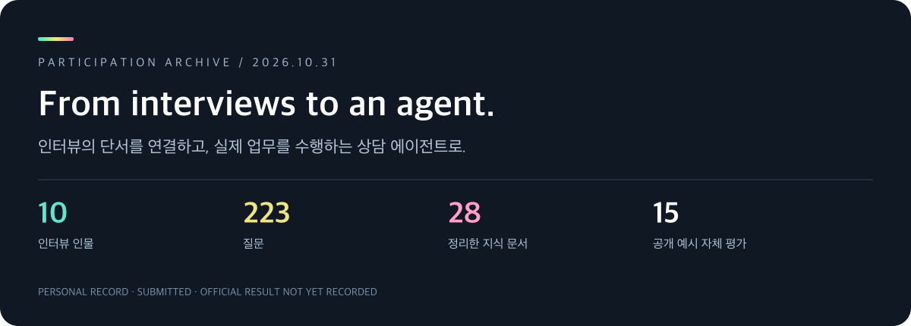
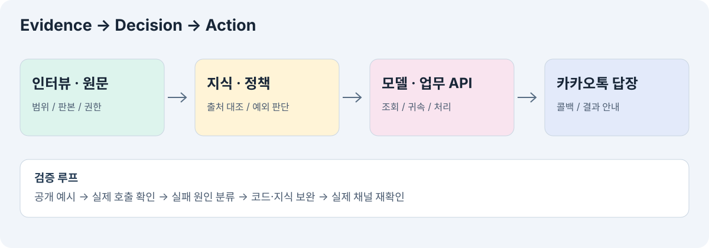
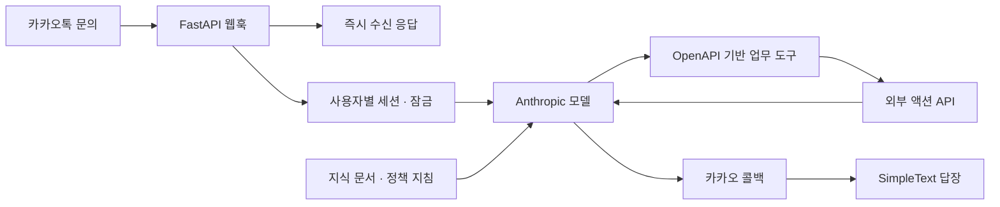
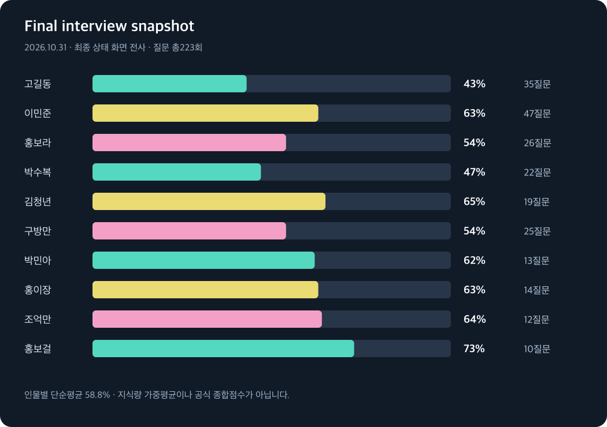

<div align="center">

<a href="https://aitop100.org/"></a>

# AI TOP 100 · 2026 Participation Archive

**김인규의 예선 참여 기록 — 인터뷰, 근거 대조, 업무 API, 그리고 카카오톡 CS 에이전트.**

[](https://aitop100.org/)
[](docs/strategy.md)
[](docs/retrospective.md)
[](skills/interview-agent-sprint/SKILL.md)

[대회 소개](https://aitop100.org/about) · [진행 타임라인](docs/timeline.md) · [최종 지표](docs/results.md) · [공식 문서 모음](docs/resources.md) · [다음 대회 플레이북](docs/next-time.md)



</div>

> **참여 사실과 문제 해결 과정을 남기는 개인 아카이브입니다.** 2026년 예선 결과물을 제출했습니다. 본선 진출·수상·공식 점수는 이 기록에서 확인되지 않았습니다. 공식 주최 측 저장소가 아닙니다.

## 어떤 도전이었나요?

AI_TOP_100은 AI와 함께 문제를 정의하고 해결하는 역량을 다루는 대회입니다. 이번 예선에서는 가상의 관계자와 인터뷰하고, 그 과정에서 얻은 맥락을 바탕으로 에이전트를 제작했습니다. [공식 대회 안내](https://aitop100.org/)

제가 풀었던 과제는 **가상 산지직송 쇼핑몰의 카카오톡 고객상담 에이전트**였습니다. 흩어진 운영 지식과 기록을 찾아, 고객에게 설명하고 실제 조회·접수까지 수행하는 흐름을 만들었습니다.

| 참여 | 만든 것 | 기록의 관점 |
|---|---|---|
| 2026.10.31 온라인 예선 | 카카오톡 CS 에이전트 | 단서 수집 → 근거 대조 → 정책 판단 → API 실행 → 검증 |
| 개인 참가: 김인규 | Python · FastAPI · Anthropic · Render | 사람이 판단하고 AI와 도구로 실행하는 과정 |

## 어떻게 풀었나요?

### 01 · 질문을 ‘대화’에서 ‘근거 수집’으로 바꿨습니다

처음에는 여러 업무를 한꺼번에 물었습니다. 이후 **한 사건·한 날짜·한 문서**로 좁히고, 필요한 원문과 소유자를 추적했습니다. 연락처가 막히면 같은 요청을 반복하기보다 실제 소개 관계와 동의 경로를 확인했습니다.

### 02 · 서로 다른 사실을 섞지 않았습니다

송장 발급과 집하, 출고 표본과 고객이 받은 상품, 과거 경험과 현행 규정, 기록된 약속과 승인·이행을 구분했습니다. 모순처럼 보이는 정보는 **시점·범위·판본·권한**을 비교했습니다.

### 03 · 말이 아닌 실제 실행을 확인했습니다

모델의 답변만 평가하지 않고 어떤 API를 호출했는지 살폈습니다. 추측한 회원 ID로 호출하는 문제는 코드 검증으로 보완했고, 접수 성공과 최종 처리 완료를 구분했습니다.

### 04 · 공개 예시와 실제 카카오톡을 오갔습니다

공개 예시를 자체 시뮬레이션하고, 취약한 흐름을 수정한 뒤 실제 채널에서 다시 확인했습니다. 자동 평가의 오판 가능성과 실제 미디어 인식 미검증도 별도로 기록했습니다.

**[전략의 전체 과정과 실제 의사결정 읽기 →](docs/strategy.md)**

## 시스템은 어떻게 연결했나요?





**구현한 것:** 문서 전체 컨텍스트·프롬프트 캐싱, 사용자별 세션, 도구 호출, 회원 ID 출처 검증, 콜백 답장.  
**구현했다고 주장하지 않는 것:** 벡터 검색 RAG, 다중 에이전트 런타임, 모든 도구의 병렬 실행, 실제 음성·이미지 인식 전수 검증.

[구조와 검증 범위 자세히 보기 →](docs/architecture.md)

## 무엇을 기록했나요?

| 지표 | 최종 기록 | 읽을 때 주의할 점 |
|---|---:|---|
| 인터뷰 인물 | **10명** | 모두 연결 |
| 질문수 | **223회** | 최종 상태 화면 합계 |
| 인물별 지식발굴률 단순평균 | **58.8%** | 전체 지식량 비율이나 공식 점수 아님 |
| 정리한 지식 문서 | **28개** | 내부 보관, 이 저장소에 원문 재배포하지 않음 |
| 자체 평가 공개 예시 | **15개** | 실제 API를 포함한 자체 평가 |
| 한 버전의 자체 평가 평균 | **80.7 / 100** | 최종 제출 버전 전수 점수 아님 |

<details>
<summary><b>인물별 최종 질문수와 지식발굴률 펼치기</b></summary>

| 인물 | 질문수 / 100 | 발굴률 |
|---|---:|---:|
| 고길동 | 35 | 43% |
| 이민준 | 47 | 63% |
| 홍보라 | 26 | 54% |
| 박수복 | 22 | 47% |
| 김청년 | 19 | 65% |
| 구방만 | 25 | 54% |
| 박민아 | 13 | 62% |
| 홍이장 | 14 | 63% |
| 조억만 | 12 | 64% |
| 홍보걸 | 10 | 73% |

가상 인물의 상태 화면을 전사한 값입니다. 인물별 전체 지식 항목 수는 알 수 없어 가중 전체 발굴률은 계산하지 않았습니다.

</details>



[측정 방법·재평가·한계 보기 →](docs/results.md)

## 무엇이 어려웠고, 다음에는 무엇을 바꿀까요?

| 겪은 문제 | 이번에 배운 점 | 다음에 할 일 |
|---|---|---|
| 연락처·문서 요청 반복 | 관계와 소유자를 먼저 알아야 함 | 초반에 조직·문서 소유 지도 작성 |
| 화면 자동화가 수동보다 느림 | 동시 추론과 동시 화면 제어는 다름 | 입력 큐와 분석 작업 분리 |
| 지식 수집과 구현이 한 대화에 몰림 | 사용자의 복붙 비용이 커짐 | 사실·질문·평가 공통 원장 |
| 모델이 ID를 추측함 | 프롬프트만으로 부족한 제약 존재 | 출처와 고객 귀속을 코드로 검증 |
| 일부 재평가만 좋아짐 | 개선과 완주 점수는 별개 | 최종 버전 전체 평가 시간 확보 |

[솔직한 회고 →](docs/retrospective.md) · [다음 대회 운영안 →](docs/next-time.md)

## 필요한 곳으로 바로 가기

| 읽고 싶은 내용 | 바로가기 |
|---|---|
| 과제 접근과 판단 과정 | [문제 해결 전략](docs/strategy.md) |
| 실제 진행 순서 | [타임라인](docs/timeline.md) |
| 기술 구조와 검증 범위 | [아키텍처](docs/architecture.md) |
| 수치와 한계 | [최종 지표](docs/results.md) · [CSV](data/interview-metrics.csv) |
| 재사용할 작업 방식 | [스킬](skills/interview-agent-sprint/SKILL.md) · [플레이북](docs/next-time.md) |
| 다음 프로젝트의 시작 양식 | [공통 기록 템플릿](templates/work-logs.md) |
| 공식 안내·개발 문서 | [링크 모음](docs/resources.md) |
| 출처와 이미지 권리 | [자료·이미지 크레딧](docs/credits.md) |

## 저장소 구성

```text
.
├── README.md                 # 참여 소개와 탐색
├── assets/                   # 공식 로고 · 직접 만든 표지/구조/지표 이미지
├── docs/                     # 전략 · 과정 · 구조 · 결과 · 회고 · 공식 링크
├── data/                     # 전사 지표와 자체평가 요약
├── skills/                   # 재사용할 인터뷰형 에이전트 작업 스킬
├── templates/                # 사실/질문/충돌/평가/인계 양식
└── scripts/                  # 로컬 링크·수치·구성 검증
```

공개용으로 다시 쓴 참여 아카이브입니다. 내부 지식 원문, 전체 문제·정답 자료, 실행 서버 설정, 비밀키, 원시 대화·콜백 로그는 포함하지 않았습니다. 제출용 비공개 저장소와 배포는 별도로 유지합니다.

---

<div align="center">

**AI를 사용한 결과뿐 아니라, AI와 문제를 풀었던 과정을 남깁니다.**

[공식 홈페이지](https://aitop100.org/) · [전략으로 돌아가기](docs/strategy.md) · [기록한 사람](https://github.com/koreadeveloper)

<sub>Personal participation archive · AI_TOP_100 공식 로고의 권리는 해당 권리자에게 있습니다. 공식 인증·수상 배지가 아닙니다.</sub>

</div>
