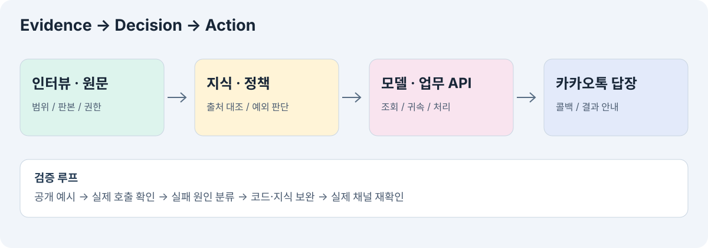

# 시스템 구조와 구현 범위

[← README](../README.md)

## 구현
Python/FastAPI 서버가 카카오 웹훅을 받고 빠르게 수신 응답을 반환한다. 백그라운드에서 사용자별 세션 잠금을 잡아 Anthropic 모델과 업무 도구를 실행한 뒤 카카오 콜백으로 SimpleText 답장을 보낸다. Render에 배포하고 별도 비공개 제출 저장소의 main과 연결했다.

| 부분 | 당시 선택 | 이유와 한계 |
|---|---|---|
| 지식 공급 | Markdown 전체 컨텍스트·캐싱 | 빠르게 원문을 반영. 규모 증가 시 비용·지연·충돌 관리 필요 |
| 업무 도구 | OpenAPI 기반 40개 정의 | 스키마 생성과 정책 판단은 별개 |
| 세션 | 사용자별 메모리·잠금·TTL | 동시 대화 충돌 완화. 영구 저장은 아님 |
| 응답 | 한 말풍선·길이 제한 | 간결성 확보. 잘림으로 필수 안내가 빠질 위험 |
| ID 제약 | 실제 성공 응답에서 얻은 ID 확인 | 출처 확인과 본인 귀속을 모두 검증해야 함 |
| 테스트 | 공개 예시·액션 API·실제 카카오톡 | 공식 평가와 동일하지 않음 |

## 수행하지 않은 것
벡터 검색 기반 RAG, 운영 중 다중 에이전트 분업, 도구 전체 병렬화, 모든 API 전수 검증, 실제 미디어 입력 전체 인식 검증, 영구 대화 데이터베이스는 구현·검증했다고 기록하지 않는다.

## 검증한 경로
로컬 회귀 검사6개, 실제 카카오톡 메시지 왕복, 대상 조회 도구 호출과 담당자 접수 결과를 확인했다. 최종 직접 API 시험에서 잘못된 테스트 식별자 표기로400을 겪었고, 올바른 식별자를 명시해 접수 성공을 재확인했다. 오류를 성공으로 알리지 않는 답변도 확인했다.
최종 카카오톡 질문에서는 송장 발급과 집하를 구분하고 조회 후 주소 변경 접수를 안내했다. 실제 주소 변경 완료까지 검증했다는 뜻은 아니다.

## 공개 범위
여기는 방법론·아키텍처 기록이다. 운영 엔드포인트·앱 식별자·비밀 환경변수·콜백 인증 정보·내부 지식 원문은 올리지 않는다. 실행 저장소나 공개 데모로 안내하지 않는다.
