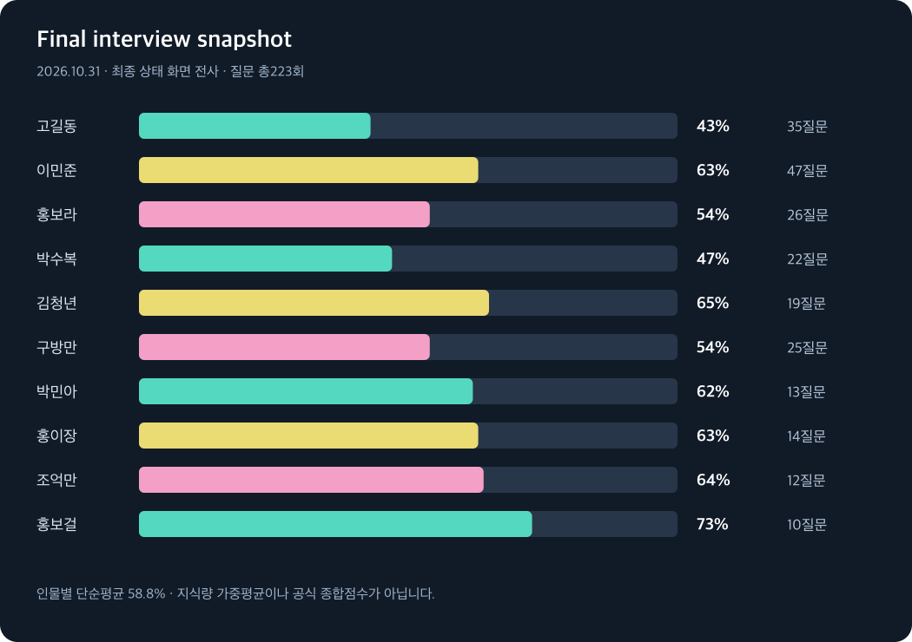

# 결과 기록과 측정 한계

[← README](../README.md) · [CSV](../data/interview-metrics.csv) · [평가 요약 JSON](../data/evaluation-summary.json)

## 인터뷰 지표
사용자가 제공한 2026-10-31 14:58:51 스크린샷의 14:55~14:56 상태 메시지를 전사했다. 합계 질문223회, 인물10명, 인물별 발굴률 단순평균58.8%. 인물마다 전체 지식 수를 몰라 지식량 가중평균은 계산할 수 없다.

## 자체 평가
공개 예시15건을 고객 시뮬레이션·실제 액션 API·모범 처리 비교로 평가한 한 버전의 평균은80.7/100이었다. 공식 채점이나 최종 제출 버전 전체 재평가는 아니다.

| 대상 | 보완 전 전체 실행에서의 점수 | 표적 재평가 | 후속 단건 실행 |
|---|---:|---:|---:|
| 빠른 출고 | 60 | 65 | 88 |
| 가격 보상 | 70 | 90 | — |
| 할인 병용 | 72 | 82 | — |
| 음성 환불 시뮬레이션 | 50 | 72 | 64 |

음성 환불은 후속 실행에서 점수가 다시 낮아졌다. 일부 성공만 골라 전체 정확도가 일관되게 상승했다고 말할 수 없다. 각 실행의 코드·프롬프트·상호작용이 달라 점수를 모아 새 전체 평균을 만들지 않았다.

## 테스트 범위
- 실제 카카오톡: 상품 비교, 권한 사칭 거절, 사진 없는 대화의 확인 주장 방지, 가족 주문 정보 비공개, 허용 선물 대안, 탈퇴 혜택, 현장 판매 문의 분리, 광고 충돌 안내, 마지막 배송지 문의 등.
- 서버 직접: 주문 조회 도구 호출, 안전 담당 접수 결과 확인. 첫 테스트 식별자 오류와 재시도도 기록.
- 로컬: 관련 회귀 테스트6개 통과.

## 해석하지 말아야 할 것
80.7을 공식 점수·정확도80.7%·TOP100 진입 확률로 읽지 않는다. 단건 지연이나 평균을p95로 부르지 않는다. 텍스트로 대체한 이미지·음성 시나리오를 실제 미디어 인식 평가로 부르지 않는다. 접수 성공이 최종 환불 완료를 뜻하지도 않는다.
본선 진출·수상·공식 순위는 미확인이다. 확인된 결과가 생기면 근거와 함께 별도로 갱신할 수 있다.
